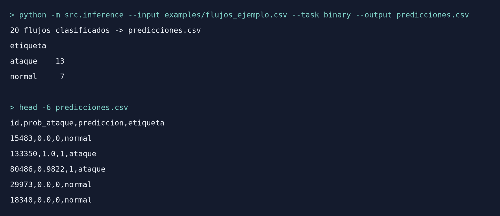
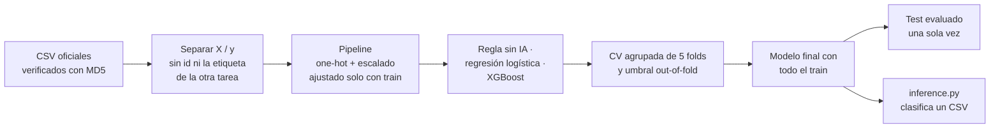
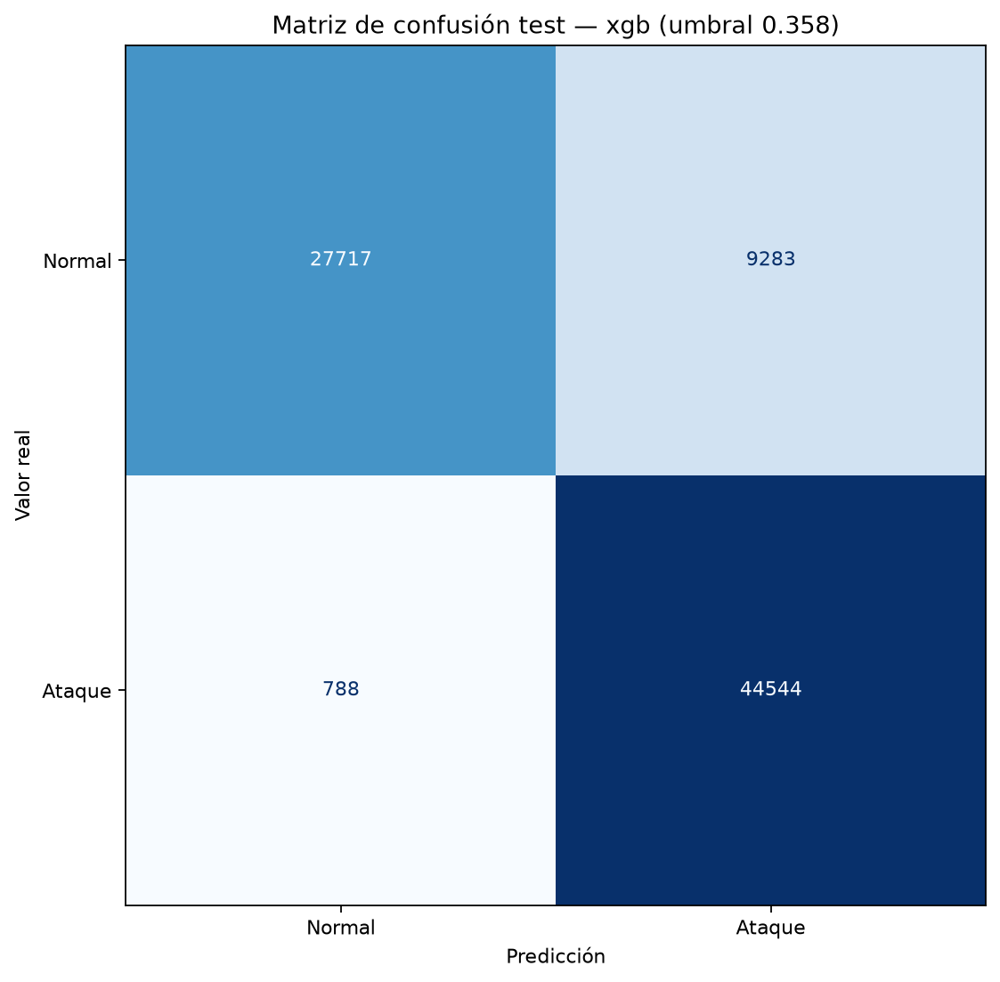

<div align="center">

# Detección de intrusiones en redes con Machine Learning

### Un detector que clasifica flujos de red como tráfico normal o ataque, y el tipo de ataque, entrenado y evaluado sobre el dataset UNSW-NB15

[](https://www.python.org/)
[](LICENSE)
[](https://github.com/agusclap/ml-network-intrusion-detection/actions/workflows/tests.yml)
[]()

[Demo en vivo](https://agusclap.github.io/ml-network-intrusion-detection/) · [Reportar un bug](../../issues) · [Pedir una funcionalidad](../../issues)

</div>

---

## 📋 Tabla de contenidos

- [Demo](#-demo)
- [Sobre el proyecto](#-sobre-el-proyecto)
  - [Contexto académico](#contexto-académico)
  - [Construido con](#construido-con)
- [El dataset](#-el-dataset)
- [Metodología](#-metodología)
- [Resultados](#-resultados)
- [Estructura del proyecto](#-estructura-del-proyecto)
- [Instalación](#-instalación)
- [Uso](#-uso)
- [Roadmap](#-roadmap)
- [Autores](#-autores)
- [Licencia](#-licencia)
- [Agradecimientos y referencias](#-agradecimientos-y-referencias)

---

## 🎬 Demo

El MVP es un script de consola: recibe un CSV con flujos de red, les aplica el mismo preprocesamiento del entrenamiento y devuelve, para cada flujo, la probabilidad de que sea un ataque y la etiqueta final. Esta es la salida real del script con los 20 flujos de ejemplo del repositorio:



También hay una **demo interactiva con Streamlit** ([streamlit_app.py](streamlit_app.py)): subís un CSV con flujos, elegís la tarea (binaria o multiclase) y la app muestra la predicción de cada flujo, un gráfico con el conteo por clase y un botón para descargar el resultado. Si el CSV trae las etiquetas reales, además muestra cuántos flujos acertó. Trae 17 flujos de ejemplo del test (8 normales y uno de cada tipo de ataque) para probarla sin subir nada. Cómo correrla, con Python o con Docker, está en [Uso](#demo-interactiva).

**🔗 Demo en vivo:** https://agusclap.github.io/ml-network-intrusion-detection/ (página con el resumen del proyecto y los resultados).

---

## 📖 Sobre el proyecto

Un sistema de detección de intrusiones en red (NIDS) mira el tráfico y avisa cuando algo parece un ataque. Los IDS tradicionales funcionan con firmas: reglas escritas a mano para ataques que ya se conocen, que no detectan bien las variantes nuevas. Nuestra propuesta es entrenar un modelo que aprenda cómo se comporta el tráfico malicioso a partir de ejemplos etiquetados, para que funcione como una capa más de detección.

El sistema recibe los datos de un **flujo de red** (una conexión entre dos equipos resumida en números: protocolo, servicio, duración, bytes y paquetes de cada lado, TTL, etc.) y resuelve dos tareas: la **binaria** (principal), que decide si el flujo es normal o un ataque, y la **multiclase** (secundaria), que predice si es Normal o una de las 9 categorías de ataque del dataset.

Comparamos dos baselines sin IA (una regla simple y "siempre la clase más frecuente") y una regresión logística contra **XGBoost**. Validamos con cross-validation sobre el train, agrupando las filas repetidas, y evaluamos cada modelo **una sola vez** sobre el test oficial.

**Resultado principal:** XGBoost detecta el **98,3 % de los ataques del test** con un F1 de 0,898, contra 0,733 de la regla sin IA. No cumple uno de los cuatro criterios que fijamos de antemano: su tasa de falsos positivos sube de 8 % en la validación a 25 % en el test. La causa es un tipo de tráfico normal, marcado por `sttl = 254`, que en el test es el doble de frecuente que en el train. Sacar las variables de TTL no lo resuelve, porque el modelo reconoce ese tráfico también por otras variables. Lo analizamos en [Resultados](#-resultados).

La propuesta completa (problema, PEAS, métricas de éxito, baselines y alcance) está en el [Project Charter](docs/informes/PROJECT_CHARTER_CORREGIDO.md), también publicado como Issue #1. El plan de trabajo está en [PLAN_IMPLEMENTACION.md](docs/informes/PLAN_IMPLEMENTACION.md), el análisis detallado de los datos en [AUDITORIA_VIABILIDAD.md](docs/informes/AUDITORIA_VIABILIDAD.md) y un resumen de estudio del proyecto en [RESUMEN_PROYECTO.md](docs/informes/RESUMEN_PROYECTO.md).

### Contexto académico

- **Asignatura:** Inteligencia Artificial (Ingeniería en Informática)
- **Institución:** Universidad de la Defensa Nacional, Centro Regional Universitario Córdoba (CRUC IUA)
- **Cohorte / año:** 2026
- **Docente:** Ing. Hernando Alexis González
- **Modalidad:** grupal

### Construido con

- [Python 3.13](https://www.python.org/)
- [pandas](https://pandas.pydata.org/) / [NumPy](https://numpy.org/)
- [scikit-learn](https://scikit-learn.org/) — preprocesamiento, regresión logística, cross-validation y métricas
- [XGBoost](https://xgboost.readthedocs.io/) — modelo principal
- [matplotlib](https://matplotlib.org/) — matrices de confusión y curvas ROC
- [Jupyter](https://jupyter.org/) — análisis exploratorio y análisis de errores
- [Streamlit](https://streamlit.io/) — demo interactiva
- [Docker](https://www.docker.com/) — para correr la demo sin instalar Python
- [uv](https://docs.astral.sh/uv/) — gestión de dependencias y entorno
- [pytest](https://docs.pytest.org/) y GitHub Actions — tests automáticos en cada cambio

---

## 📊 El dataset

| Campo | Detalle |
|---|---|
| Fuente | [UNSW-NB15](https://research.unsw.edu.au/projects/unsw-nb15-dataset), Australian Centre for Cyber Security, UNSW Canberra (Moustafa y Slay, 2015) |
| Registros | 175.341 en `UNSW_NB15_training-set.csv` y 82.332 en `UNSW_NB15_testing-set.csv` (la división oficial de los autores); 31 MB y 15 MB |
| Variables | 45 columnas: 42 de entrada (39 numéricas y 3 categóricas: `proto`, `service`, `state`), `id` y las dos etiquetas |
| Variable objetivo | `label` en la tarea binaria (0 = normal, 1 = ataque) y `attack_cat` en la multiclase (Normal o Analysis, Backdoor, DoS, Exploits, Fuzzers, Generic, Reconnaissance, Shellcode, Worms) |
| Período / cobertura | Tráfico generado en 2015 en el laboratorio Cyber Range de UNSW Canberra, mezclando actividad normal real con ataques sintéticos |
| Licencia del dataset | Uso libre con fines académicos y de investigación, citando los trabajos de los autores; el uso comercial requiere su acuerdo |

Los datos **no están en el repositorio** por su tamaño. En [data/README.md](data/README.md) explicamos cómo descargarlos de la fuente oficial y cómo comprobar con su hash MD5 que son exactamente los archivos que usamos. Ojo con la copia que hay en Kaggle: tiene los nombres de train y test intercambiados. También hay una copia en Hugging Face, con el mismo problema (ver [data/README.md](data/README.md)).

Elegimos este dataset porque es público, conocido y viene con una división oficial en train y test, así que los resultados se pueden comparar. Además permite armar un baseline sin IA con sentido y tiene problemas reales para analizar: clases que se superponen, un sesgo en el TTL y diferencias entre train y test.

---

## 🔬 Metodología



### Análisis exploratorio

El análisis está en [notebooks/01_eda_minimo.ipynb](notebooks/01_eda_minimo.ipynb). Lo que encontramos y qué decidimos a partir de eso:

- **No hay valores faltantes.** Algunos valores de `state` aparecen solo en el test, así que el encoding tiene que soportar categorías nuevas.
- **Desbalance.** 68 % de ataques en el train y 55 % en el test. Entre categorías es mucho más fuerte: Generic tiene 40.000 filas y Worms 130. Lo manejamos con pesos por clase y métricas que no se engañan con el desbalance.
- **Filas repetidas.** El 38 % de las filas del train está repetida. No las eliminamos, porque son flujos reales que se repiten (por ejemplo, durante un escaneo), pero las tenemos en cuenta al validar.
- **Filas idénticas con distinta etiqueta.** Cerca del 17 % de las filas del train tiene los mismos valores en las 42 variables que otra fila de otra categoría, sobre todo entre Analysis, Backdoor, DoS y Exploits. Ningún modelo puede separarlas: el Macro-F1 máximo posible en el train ronda 0,81.
- **Sesgo del TTL.** `sttl`, `dttl` y `ct_state_ttl` separan casi solas el tráfico normal de los ataques, por cómo se generó el tráfico en el laboratorio. No es data leakage (el TTL existe en una red real), pero sí un sesgo del dataset. En el MVP las dejamos y lo anotamos como riesgo. En el trabajo final probamos sacarlas: el modelo rinde igual y las falsas alarmas del test no bajan (ver [Experimento sin TTL](#experimento-xgboost-sin-las-variables-de-ttl)).
- **Outliers.** Varias variables tienen valores muy extremos (por ejemplo, `sbytes` llega a casi 13 MB con una mediana de 430 bytes). No los eliminamos: en tráfico de red son legítimos y muchas veces son la señal del ataque.
- **Train y test.** Alrededor del 5 % de las filas del test también están en el train. Evaluamos sobre el test completo porque es el benchmark oficial.

### Preprocesamiento

- En cada tarea se sacan de la entrada `id` y la etiqueta de la otra tarea, porque `attack_cat` revela `label` y al revés. `get_X_y` lo verifica.
- **One-hot encoding** de las 3 categóricas. Las categorías con menos de 50 filas se agrupan en una sola columna, y quedan 188 columnas. Una categoría nueva queda con todas sus columnas en 0 y no rompe nada.
- **Estandarización** de las numéricas, solo para la regresión logística, porque es un modelo lineal y le afecta la escala. XGBoost usa árboles y no lo necesita.
- Todo va dentro de un `Pipeline` de scikit-learn que se ajusta **solo con los datos de entrenamiento** de cada fold y después se aplica a validación y test. La carpeta `data/processed/` queda vacía a propósito: no guardamos datos transformados, porque el preprocesamiento viaja con el modelo.
- **Desbalance:** pesos por clase (`class_weight` en la regresión logística y `sample_weight` en XGBoost), calculados con el fold de entrenamiento. No generamos datos sintéticos y el test nunca se balancea.
- **Etiqueta multiclase:** `attack_cat` se codifica con un `LabelEncoder` ajustado con el train y guardado junto con el modelo.

### Modelo(s)

| Modelo | Rol | Por qué |
|---|---|---|
| Regla `dpkts == 0` | Baseline sin IA (binaria) | Si el destino no respondió ningún paquete, es ataque. Es típico de escaneos y algunos DoS, y muestra cuánto se puede lograr sin aprender nada. |
| Clase mayoritaria | Baseline sin IA (multiclase) | Es el piso mínimo para la multiclase. |
| Regresión logística (L2, `C = 1`, pesos por clase) | Baseline de ML | Es un modelo lineal simple e interpretable: si XGBoost no le gana, la complejidad extra no se justifica. |
| **XGBoost** (400 árboles, profundidad 6, tasa 0,1) | Modelo principal | Funciona muy bien con datos tabulares y variables heterogéneas, combina condiciones sobre varias variables y no necesita escalado. |

En el MVP, los hiperparámetros se fijaron antes de entrenar, sin búsqueda. En el trabajo final los comparamos con una búsqueda en grilla con cross-validation, y los del MVP se mantienen porque ninguna configuración los mejora al umbral con el que funciona el modelo (ver [Búsqueda de hiperparámetros](#búsqueda-de-hiperparámetros)). La semilla es 42 en todo el proyecto.

En el trabajo final, el modelo principal pasa a ser **XGBoost sin las tres variables de TTL** (`xgb_sinttl`), con los mismos hiperparámetros. En la cross-validation rinde igual, usa tres variables menos y no depende de la topología de la red donde se capturó el tráfico. La decisión y el resultado están en [Experimento sin TTL](#experimento-xgboost-sin-las-variables-de-ttl).

### Validación

- **Cross-validation de 5 folds** sobre el train con `StratifiedGroupKFold`: las filas con los mismos valores en las 42 variables forman un grupo y cada grupo cae entero en un fold. Así ninguna fila repetida queda en entrenamiento y en validación a la vez. Cada fold mantiene la proporción de clases del train. Lo cambiamos por recomendación de la cátedra: con un `StratifiedKFold` común, las métricas salían infladas por memorización.
- **Umbral de decisión (binaria):** con las predicciones out-of-fold elegimos el umbral con mejor F1 entre los que detectan al menos el 90 % de los ataques. Se guarda con el modelo y nunca se recalcula con el test.
- **Test:** el modelo final se entrena con todo el train y se evalúa **una sola vez** en el test oficial. Es una convención que respetamos: `evaluate.py` avisa si ese modelo ya fue evaluado, pero el chequeo se saltea borrando el JSON. Lo que lo garantiza es el proceso: el criterio y el umbral se fijaron antes, y en el historial cada evaluación del test tiene un único commit. En el trabajo final evaluamos un modelo más, `xgb_sinttl`. Antes de correrlo dejamos escrita en la [issue #24](https://github.com/agusclap/ml-network-intrusion-detection/issues/24) la decisión de usarlo como modelo principal, y que el resultado del test no la iba a cambiar.
- **Métricas:** priorizamos el recall porque en un NIDS el error más grave es un ataque no detectado, pero controlamos la tasa de falsos positivos, porque un detector que da alarma por todo no sirve. No usamos accuracy como métrica principal porque con clases desbalanceadas engaña. En la multiclase usamos Macro-F1, que pesa igual a todas las clases.

---

## 📈 Resultados

Resultados de la tarea binaria en el **test**, con cada modelo evaluado una sola vez:

| Métrica | Baseline: regla sin IA | Regresión logística | Modelo final: XGBoost |
|---|---|---|---|
| Recall (ataques detectados) | 0,658 | 0,964 | **0,983** |
| Tasa de falsos positivos | **0,167** | 0,372 | 0,251 |
| Precisión | 0,828 | 0,761 | **0,828** |
| F1 | 0,733 | 0,850 | **0,898** |
| ROC-AUC | 0,745 | 0,956 | **0,984** |
| Macro-F1 (multiclase) | 0,062 (clase mayoritaria) | 0,352 | **0,524** |



### Cross-validation sobre el train

Media ± desviación estándar de los 5 folds.

**Tarea binaria, umbral 0,5:**

| Modelo | F1 | Recall | Precisión | Tasa de falsos positivos | ROC-AUC |
|---|---|---|---|---|---|
| Regla sin IA (`dpkts == 0`) | 0,762 ± 0,003 | 0,650 ± 0,004 | 0,921 ± 0,001 | 0,119 ± 0,002 | 0,766 |
| Regresión logística | 0,950 ± 0,001 | 0,952 ± 0,001 | 0,949 ± 0,001 | 0,109 ± 0,002 | 0,984 |
| XGBoost | **0,965 ± 0,001** | **0,955 ± 0,002** | **0,976 ± 0,001** | **0,050 ± 0,002** | **0,993** |

**Tarea binaria, umbral elegido con las predicciones out-of-fold:**

| Modelo | Umbral | Recall | Tasa de falsos positivos | F1 |
|---|---|---|---|---|
| Regresión logística | 0,367 | 0,982 | 0,162 | 0,954 |
| XGBoost | 0,358 | 0,974 | 0,080 | 0,968 |

**Tarea multiclase:**

| Modelo | Macro-F1 | Weighted-F1 | Exactitud balanceada |
|---|---|---|---|
| Clase mayoritaria | 0,048 ± 0,000 | 0,155 | 0,100 |
| Regresión logística | 0,412 ± 0,005 | 0,716 | 0,585 |
| XGBoost | **0,620 ± 0,008** | **0,803** | **0,700** |

F1 por clase de XGBoost: Generic 0,990 · Normal 0,912 · Reconnaissance 0,827 · Fuzzers 0,750 · Shellcode 0,702 · Worms 0,680 · Exploits 0,652 · DoS 0,379 · Analysis 0,184 · Backdoor 0,121.

- Los dos modelos de ML superan ampliamente a la regla sin IA, que solo detecta el 65 % de los ataques.
- XGBoost detecta casi los mismos ataques que la regresión logística con menos de la mitad de falsos positivos: la logística separa las clases con una frontera lineal, y los árboles combinan condiciones sobre varias variables.
- En la multiclase, XGBoost supera a los baselines por mucho más que la variación entre folds y reconoce bien clases muy chicas como Worms y Shellcode. Analysis, Backdoor y DoS quedan bajas en todos los modelos por las filas idénticas con otras categorías.
- **Al agrupar las filas repetidas**, XGBoost binario bajó un poco (F1 de 0,967 a 0,965, falsos positivos de 4,6 % a 5,0 %): esa diferencia venía de filas de validación que el modelo ya había visto. En la multiclase, Analysis, DoS y Backdoor mejoraron (de 0,12 a 0,18, de 0,32 a 0,38 y de 0,07 a 0,12).

### Evaluación final sobre el test

**Tarea multiclase:**

| Modelo | Macro-F1 | Weighted-F1 | Exactitud balanceada |
|---|---|---|---|
| Clase mayoritaria | 0,062 | 0,279 | 0,100 |
| Regresión logística | 0,352 | 0,685 | 0,548 |
| XGBoost | **0,524** | **0,741** | **0,644** |

F1 por clase de XGBoost: Generic 0,984 · Reconnaissance 0,856 · Normal 0,759 · Worms 0,756 · Exploits 0,698 · Shellcode 0,396 · Fuzzers 0,375 · DoS 0,260 · Backdoor 0,105 · Analysis 0,053.

**Criterios de éxito fijados en el Charter antes de entrenar:**

| Criterio | Resultado en el test | ¿Se cumple? |
|---|---|---|
| Binaria: recall de al menos 0,90 | 0,983 | Sí |
| Binaria: tasa de falsos positivos no mayor que la de la regla sin IA (0,167) | 0,251 | **No** |
| Binaria: mejor F1 que los dos baselines | 0,898 contra 0,733 y 0,850 | Sí |
| Multiclase: mantener la ventaja en Macro-F1 sobre los dos baselines | 0,524 contra 0,062 y 0,352 | Sí |

Las matrices de confusión y curvas ROC de todos los modelos, en la cross-validation y en el test, están en [reports/figures/](reports/figures/), y las métricas completas en JSON en [reports/metrics/](reports/metrics/).

### Análisis crítico: por qué aumentan los falsos positivos en el test

XGBoost es el mejor modelo en las dos tareas, pero **no cumple el criterio de falsos positivos**: en la cross-validation tenía 8,0 % y en el test sube a 25,1 %. Casi todas las falsas alarmas tienen el mismo valor de `sttl` (el TTL de los paquetes del origen). Proporción de flujos con cada valor:

| `sttl` | Normales en train | Ataques en train | Normales en test |
|---|---|---|---|
| 31 | 70,5 % | 0 % | 45,1 % |
| 254 | 20,1 % | 86,7 % | 40,7 % |

- En el train, `sttl = 254` aparece en el 87 % de los ataques y solo en el 20 % del tráfico normal, así que el modelo lo aprendió como señal de ataque. Es el sesgo del TTL que ya habíamos marcado como riesgo.
- En el test, el tráfico normal con `sttl = 254` se duplica. De los 9.283 falsos positivos de XGBoost, 8.099 (el 87 %) tienen ese valor. Los flujos normales con `sttl = 31` no generan ninguna falsa alarma.
- No es algo solo de nuestro modelo: la regla sin IA también empeora (de 0,119 a 0,167). El tráfico normal del test es distinto al del train.
- El modelo multiclase clasifica como Fuzzers 7.402 de esas falsas alarmas; por eso en el test baja el F1 de Normal y la precisión de Fuzzers es de 0,26.
- El ROC-AUC sigue en 0,984: el modelo ordena bien los flujos. Lo que falla es el umbral elegido con el train, porque cambió la distribución del tráfico normal.

**No cambiamos el umbral ni el modelo después de ver el test**, porque el resultado dejaría de ser una evaluación independiente. Lo reportamos como está. El análisis completo está en [notebooks/02_analisis_test.ipynb](notebooks/02_analisis_test.ipynb). En el MVP pensamos que entrenar sin las variables de TTL podía resolverlo. Lo probamos en el trabajo final y no alcanza (ver la sección siguiente). Para usar el modelo en otra red hay que volver a elegir el umbral con tráfico de esa red (ver [Roadmap](#-roadmap)).

### Experimento: XGBoost sin las variables de TTL

Para medir cuánto depende el modelo del TTL, entrenamos el mismo XGBoost, con los mismos hiperparámetros, sin `sttl`, `dttl` ni `ct_state_ttl`. Las tres columnas se sacan dentro del `Pipeline`, así que el modelo guardado las ignora aunque el CSV las traiga. Los grupos de la cross-validation se arman sin esas columnas: si no, dos flujos que solo difieren en el TTL, y que el modelo ve idénticos, podrían caer uno en entrenamiento y otro en validación.

**Cross-validation (5 folds, train):**

| Modelo | F1 | Recall | Tasa de falsos positivos | ROC-AUC | Al umbral OOF: recall / falsos positivos |
|---|---|---|---|---|---|
| XGBoost | 0,965 ± 0,001 | 0,955 ± 0,002 | 0,050 ± 0,002 | 0,993 | 0,974 / 0,080 |
| XGBoost sin TTL | 0,964 ± 0,001 | 0,954 ± 0,001 | 0,051 ± 0,003 | 0,993 | 0,975 / 0,081 |

En el train rinden igual: todas las diferencias son menores que la variación entre folds. Las otras variables ya traen la información del TTL.

**Decisión, tomada antes de evaluar en el test** y registrada en la [issue #24](https://github.com/agusclap/ml-network-intrusion-detection/issues/24): el modelo principal pasa a ser XGBoost sin TTL. Como en la cross-validation empatan, elegimos por dos razones que no dependen del test. La primera es la parsimonia: rinde lo mismo con tres variables menos. La segunda es el dominio: el TTL depende de cuántos saltos hay en la red donde se capturó el tráfico, no del tipo de ataque, así que un modelo que se apoya en él aprende cómo estaba armado el laboratorio. El test se evaluó una vez solo para medir el efecto, sin posibilidad de cambiar la decisión. Hay una limitación que conviene decir: la sospecha sobre el TTL salió del análisis de errores del test, así que esta evaluación no es del todo ciega.

**Test:**

| Modelo | Recall | Tasa de falsos positivos | Precisión | F1 | ROC-AUC |
|---|---|---|---|---|---|
| XGBoost | 0,983 | 0,251 | 0,828 | 0,898 | 0,984 |
| XGBoost sin TTL | 0,979 | 0,255 | 0,825 | 0,895 | 0,982 |

- **Sacar el TTL no baja las falsas alarmas.** Son 9.421 contra 9.283, y 8.628 de esos flujos son los mismos en los dos modelos.
- **El 87 % de las falsas alarmas sigue teniendo `sttl = 254`** (8.196 de 9.421), aunque este modelo nunca ve esa columna. El TTL no era la causa: era una marca de un tipo de tráfico normal que se parece a un ataque también en otras variables.
- En esas falsas alarmas, las variables que más empujan la predicción hacia "ataque" son `ackdat`, `synack` y `tcprtt`. Las tres miden tiempos de ida y vuelta de TCP, así que también dependen de la red y no del ataque. Lo medimos con las contribuciones por variable que calcula XGBoost (`pred_contribs`).
- El problema de fondo es un **cambio en la distribución del tráfico normal**. Ese tráfico es el 20 % de los flujos normales del train y el 41 % de los del test. Sacar variables no lo corrige: hace falta tráfico normal de la red donde se vaya a usar el modelo, o recalibrar el umbral con ese tráfico.

Las métricas completas están en `reports/metrics/binary_xgb_sinttl_cv.json` y `binary_xgb_sinttl_test.json`.

### Búsqueda de hiperparámetros

Es la mejora propia del trabajo final ([issue #28](https://github.com/agusclap/ml-network-intrusion-detection/issues/28)). Los hiperparámetros del MVP se habían fijado a mano. Acá los elegimos con la misma cross-validation agrupada de 5 folds sobre el train, sin usar el test, que es lo que indica la teoría: si se eligen mirando el conjunto de evaluación, el modelo termina ajustado a ese conjunto. La búsqueda se hizo sobre XGBoost sin TTL, el modelo principal.

**Lo que fijamos antes de correr**, registrado en la issue:

| Hiperparámetro | Valores | Qué controla |
|---|---|---|
| `max_depth` | 4, **6**, 8 | Complejidad: árboles más profundos tienen menos sesgo y más varianza |
| `learning_rate` | 0.05, **0.1**, 0.2 | La tasa de aprendizaje: cuánto corrige cada árbol a los anteriores |
| `min_child_weight` | **1**, 10 | Regularización: no deja crear hojas con pocas filas |

Son 18 configuraciones, con 400 árboles fijos. En negrita está la configuración del MVP, que entra como referencia. La métrica es el F1 promedio de los 5 folds. La regla: se elige la de mayor F1, salvo que la diferencia con la actual sea menor que el desvío entre folds, en cuyo caso se mantiene la actual. Usamos una grilla chica y una regla de empate porque, al elegir la mejor entre muchas configuraciones, se elige en parte la que tuvo más suerte con el ruido de la CV, y su F1 sale optimista.

**Resultado** (las 18 configuraciones están en `reports/metrics/binary_xgb_sinttl_tuning.json`):

| `max_depth` | `learning_rate` | `min_child_weight` | F1 (umbral 0,5) | Tasa de falsos positivos (umbral 0,5) |
|---|---|---|---|---|
| 8 | 0.2 | 1 | **0,9665 ± 0,0013** | 0,066 |
| 8 | 0.1 | 1 | 0,9665 ± 0,0010 | 0,057 |
| 6 | 0.2 | 1 | 0,9654 ± 0,0016 | 0,058 |
| 6 | 0.1 | 1 (MVP) | 0,9645 ± 0,0014 | 0,051 |
| 4 | 0.05 | 10 | 0,9572 ± 0,0015 | 0,049 |

La regla eligió (8, 0.2, 1): mejora el F1 en 0,0020, más que el desvío entre folds. Prácticamente empata con (8, 0.1, 1), por una diferencia de 0,000006. Con más profundidad y más tasa de aprendizaje, sube el F1 y también la tasa de falsos positivos.

**La corrección, hecha antes de tocar el test.** Antes de evaluar, entrenamos la configuración elegida (`xgb_tuned`) con el mismo proceso que el modelo final y comparamos al umbral OOF, que es con el que clasifica el sistema:

| Cross-validation | MVP (6, 0.1, 1) | Elegida (8, 0.2, 1) |
|---|---|---|
| F1 al umbral 0,5 (la métrica de la búsqueda) | 0,9645 | **0,9665** |
| ROC-AUC | **0,9933** | 0,9931 |
| F1 al umbral OOF | **0,9685** | 0,9678 |
| Tasa de falsos positivos al umbral OOF | **0,081** | 0,089 |
| Recall al umbral OOF | 0,975 | **0,977** |

Al umbral real, la configuración elegida no mejora: tiene un F1 un poco menor y más falsas alarmas. El ROC-AUC es el mismo, así que el modelo más profundo no separa mejor los ataques del tráfico normal. Lo que hace es correr sus probabilidades hacia arriba, y eso le da más recall con el umbral fijo en 0,5. Cuando el umbral se vuelve a elegir, esa ventaja desaparece. El error estuvo en la métrica de selección: medía el modelo con un umbral que el sistema no usa.

**Decisión**, registrada en la issue antes de evaluar: se mantienen los hiperparámetros del MVP. El modelo final sigue siendo `xgb_sinttl`, que es equivalente y más simple, y `xgb_tuned` no se evalúa en el test. La regla previa existe para proteger el test, y el test no se tocó. El cambio corrige qué se mide, y lleva al modelo más simple.

**Conclusiones:**
- Los hiperparámetros del MVP ya estaban cerca del óptimo de esta grilla.
- Una mejora de F1 con el umbral fijo puede ser solo un corrimiento de las probabilidades. Para comparar modelos que después eligen su propio umbral, hay que medirlos a ese umbral o con una métrica que no dependa de él, como el ROC-AUC.
- **Limitación:** al umbral OOF solo comparamos la configuración elegida y la del MVP, no las 18. Repetir la búsqueda con esa métrica queda en el [Roadmap](#-roadmap).

La CV de `xgb_tuned` está en `reports/metrics/binary_xgb_tuned_cv.json`.

### Reproducibilidad

- Los datos se verifican con su MD5 antes de usarlos, la semilla es 42 en todo el proyecto y las versiones de las librerías están fijas en `pyproject.toml` y `requirements.txt`.
- En la misma máquina, volver a correr todo da exactamente los mismos números. Lo comprobamos clonando el repositorio en un entorno nuevo y repitiendo el entrenamiento y la evaluación: los JSON de métricas salen idénticos.
- En otra máquina (Linux con 8 núcleos, contra Windows con 20) los datos, los grupos y los folds salen idénticos, pero los modelos cambian en el tercer decimal por diferencias de redondeo del procesador. Eso mueve un poco el umbral (0,346 en vez de 0,358 en XGBoost) sin cambiar las conclusiones: en esa máquina XGBoost dio en la cross-validation un recall de 0,976 y una tasa de falsos positivos de 0,084.

---

## 📂 Estructura del proyecto

```text
.
├── README.md
├── pyproject.toml              # dependencias con versiones exactas
├── requirements.txt            # todas las dependencias, incluidas las transitivas, fijadas
├── LICENSE
├── streamlit_app.py            # demo interactiva: clasifica un CSV subido desde el navegador
├── Dockerfile                  # imagen de la demo (Python 3.13 + dependencias + modelos XGBoost)
├── .dockerignore               # deja afuera de la imagen los datos, el entorno y los notebooks
├── src/
│   ├── config.py               # semilla, rutas, hashes MD5, columnas e hiperparámetros
│   ├── data.py                 # verificación y carga de los datos; X / y sin la etiqueta de la otra tarea
│   ├── features.py             # preprocesamiento (one-hot y escalado)
│   ├── baselines.py            # regla sin IA y clase mayoritaria
│   ├── metrics.py              # métricas y elección del umbral
│   ├── train.py                # cross-validation, umbral y entrenamiento del modelo final
│   ├── tune.py                 # búsqueda de hiperparámetros de XGBoost con la misma CV (no toca el test)
│   ├── evaluate.py             # evaluación única de los modelos guardados sobre el test
│   ├── plots.py                # matrices de confusión y curvas ROC
│   └── inference.py            # el MVP: clasifica un CSV de flujos con un modelo guardado
├── notebooks/
│   ├── 01_eda_minimo.ipynb     # análisis exploratorio
│   └── 02_analisis_test.ipynb  # análisis de los errores en el test
├── data/
│   ├── README.md               # cómo descargar y verificar los datos
│   ├── raw/                    # los dos CSV oficiales (no se suben)
│   └── processed/              # vacía: el preprocesamiento va dentro del Pipeline del modelo
├── models/                     # modelos entrenados: solo se suben los dos XGBoost (para la demo); el resto se genera con train.py
├── reports/
│   ├── metrics/                # métricas en JSON (*_cv.json y *_test.json)
│   └── figures/                # matrices de confusión y curvas ROC
├── examples/                   # CSV de ejemplo: 20 flujos sin etiquetas y 17 del test con etiquetas (para la demo)
├── tests/                      # tests con pytest sobre datos sintéticos (corren en GitHub Actions)
├── .github/workflows/          # CI: corre los tests en cada push a main y en cada PR
└── docs/                       # demo estática (GitHub Pages) e imágenes del README
    ├── index.html
    ├── img/
    ├── informes/               # Charter, plan, auditoría de datos y resumen
    └── assets/
```

---

## ⚙️ Instalación

### Prerrequisitos

- [uv](https://docs.astral.sh/uv/getting-started/installation/) (o Python 3.12 o superior con `pip`)
- Git

### Pasos

```bash
# 1. Cloná el repositorio
git clone https://github.com/agusclap/ml-network-intrusion-detection.git
cd ml-network-intrusion-detection

# 2. Creá el entorno virtual (probado con Python 3.13)
uv venv --python 3.13

# 3. Activalo
# Windows:
.venv\Scripts\activate
# Linux/Mac:
source .venv/bin/activate

# 4. Instalá las dependencias
uv pip install -e .
```

Sin uv, el mismo resultado se logra con `python -m venv .venv`, activando el entorno y corriendo `pip install -e .`. Para replicar exactamente nuestro entorno, incluidas las dependencias transitivas, está `pip install -r requirements.txt`.

**5. Descargá los datos.** Seguí los pasos de [data/README.md](data/README.md) para bajar los dos CSV oficiales y dejarlos en `data/raw/`. Después verificalos:

```bash
python -m src.data
```

El proyecto no usa variables de entorno ni credenciales, así que no hace falta un archivo `.env`.

---

## ▶️ Uso

Todos los comandos se corren desde la raíz del repositorio, con el entorno activado.

```bash
# Cross-validation, elección del umbral y entrenamiento del modelo final (guarda models/*.joblib)
python -m src.train --model xgb                       # tarea binaria (también: heuristic, lr)
python -m src.train --task multiclass --model xgb     # tarea multiclase
python -m src.train --model xgb_sinttl                # binaria sin las variables de TTL (trabajo final)

# Búsqueda de hiperparámetros: 18 configuraciones con CV, unos 10 minutos (trabajo final)
python -m src.tune
python -m src.train --model xgb_tuned                 # CV y umbral de la configuración que eligió la búsqueda

# Evaluación final sobre el test, con los modelos ya entrenados
python -m src.evaluate --task binary --model xgb      # también: heuristic, lr
python -m src.evaluate --task multiclass --model xgb

# Clasificar un CSV de flujos con el modelo guardado
python -m src.inference --input examples/flujos_ejemplo.csv --task binary --output predicciones.csv
python -m src.inference --input examples/flujos_ejemplo.csv --task multiclass --output predicciones.csv
```

Entrenar los 6 modelos (3 por tarea) tarda unos 9 minutos en nuestra máquina. Cada corrida de `train.py` imprime las métricas de cada fold y su promedio, y guarda el modelo y sus métricas en `models/` y `reports/metrics/`.

`inference.py` verifica que el CSV tenga las 42 columnas que espera el modelo (si falta alguna, corta con un error que dice cuáles; si sobran, las ignora con un aviso), aplica el preprocesamiento y el umbral guardados, y escribe un CSV con el `id`, la probabilidad y la etiqueta de cada flujo. La salida esperada es la de la captura de la [Demo](#-demo). En la tarea multiclase devuelve la categoría y su probabilidad.

`evaluate.py` no entrena nada: carga el modelo guardado y calcula las métricas sobre el test. Como las métricas del test ya están en el repositorio, para volver a evaluar hay que borrar antes los `reports/metrics/*_test.json`; si no, avisa y no corre, para que el test no se evalúe dos veces sin querer (es un recordatorio, no una protección). Con `--split train` se puede probar el script sin tocar el test.

Los notebooks se abren con Jupyter (o desde VS Code) usando el kernel del entorno `.venv`. `01_eda_minimo.ipynb` necesita los datos y `02_analisis_test.ipynb` necesita además los modelos entrenados.

### Demo interactiva

La demo usa los dos modelos XGBoost que ya están en `models/`, así que no hace falta descargar los datos ni entrenar. Se puede correr con Python o con Docker, y en los dos casos queda en http://localhost:8501.

```bash
# Con Python, con el entorno activado
streamlit run streamlit_app.py

# Con Docker, sin instalar Python ni dependencias
docker build -t nids-demo .
docker run --rm -p 8501:8501 nids-demo
```

El CSV tiene que traer las 42 variables de UNSW-NB15. Si le falta alguna, la app avisa cuáles en vez de cortar. Si trae `label` (binaria) o `attack_cat` (multiclase), compara la predicción con la etiqueta real y muestra el porcentaje de aciertos. Con los 17 flujos de ejemplo, la tarea binaria acierta 15 (88 %): detecta los 9 ataques y marca como ataque 2 de los 8 flujos normales, que tienen `sttl = 254`. Por eso la tabla muestra también esa columna, para ver el sesgo del TTL que explicamos en [Resultados](#-resultados).


### Tests

Los tests usan datos sintéticos chicos, así que no necesitan el dataset ni los modelos entrenados. Se instalan con el grupo de dependencias `dev` y se corren con pytest:

```bash
uv pip install -e ".[dev]"     # o: pip install -e ".[dev]"
pytest -v
```

Comprueban que `get_X_y` no deje pasar `id` ni las etiquetas a la entrada, que las filas idénticas caigan en el mismo grupo y que ningún grupo quede en entrenamiento y validación a la vez, que el umbral elegido cumpla el recall mínimo, y que `validate_input` rechace un CSV al que le falta una columna. GitHub Actions los corre en cada push a `main` y en cada pull request ([.github/workflows/tests.yml](.github/workflows/tests.yml)).

---

## 🗺️ Roadmap

- [x] Entrenar sin las variables de TTL (`sttl`, `dttl`, `ct_state_ttl`) para medir cuánto dependen los modelos de ese sesgo. Rinde igual y no baja las falsas alarmas del test: el problema es un cambio en el tráfico normal, no esas variables (ver [Experimento sin TTL](#experimento-xgboost-sin-las-variables-de-ttl)).
- [ ] Evaluar sobre la parte del test que no aparece en el train, y recalibrar el umbral con tráfico de la red donde se vaya a usar.
- [x] Búsqueda de hiperparámetros de XGBoost con cross-validation (18 configuraciones). Los del MVP se mantienen: al umbral OOF ninguna los mejora (ver [Búsqueda de hiperparámetros](#búsqueda-de-hiperparámetros)).
- [ ] Repetir la búsqueda midiendo cada configuración a su umbral OOF, o con ROC-AUC, en vez del F1 al umbral 0,5.
- [ ] Analizar qué variables pesan más en las predicciones.
- [x] Tests automáticos con pytest y GitHub Actions sobre la separación de X / y, la agrupación de la CV, la elección del umbral y la validación de `inference.py`.
- [x] Una demo interactiva con Streamlit que clasifique un CSV subido por el usuario, empaquetada con Docker.

---

## 👥 Autores

- **Maximo Agustin Rodeyro** — [GitHub](https://github.com/agusclap). Configuración, carga de datos, preprocesamiento, entrenamiento con cross-validation, evaluación, script de inferencia y documentación.
- **Lautaro Niccolini** — [GitHub](https://github.com/Lauti00). Análisis exploratorio, baselines y métricas, matrices de confusión y curvas ROC, y prueba de reproducibilidad en otra máquina.

Trabajamos con la rama `main` siempre estable y una rama por tarea. En cada commit indicamos qué se hizo y cuántas horas llevó, por ejemplo `feat(data): verificación MD5 de los CSV oficiales [0.5h]`.

---

## 📄 Licencia

El código de este proyecto está bajo la licencia [MIT](LICENSE). Ver el archivo `LICENSE` para más detalle. El dataset UNSW-NB15 no se redistribuye en este repositorio y tiene sus propias condiciones de uso (ver [El dataset](#-el-dataset)).

---

## 🙏 Agradecimientos y referencias

- Moustafa, N. y Slay, J. (2015). UNSW-NB15: a comprehensive data set for network intrusion detection systems (UNSW-NB15 network data set). *Military Communications and Information Systems Conference (MilCIS)*, IEEE. https://doi.org/10.1109/MilCIS.2015.7348942
- Moustafa, N. y Slay, J. (2016). The evaluation of Network Anomaly Detection Systems: Statistical analysis of the UNSW-NB15 dataset and the comparison with the KDD99 dataset. *Information Security Journal: A Global Perspective*.
- UNSW Canberra. The UNSW-NB15 Dataset. https://research.unsw.edu.au/projects/unsw-nb15-dataset
- Documentación de [scikit-learn](https://scikit-learn.org/stable/) (`Pipeline`, `ColumnTransformer`, `StratifiedGroupKFold`) y de [XGBoost](https://xgboost.readthedocs.io/).
- Al Ing. Hernando Alexis González, por la revisión del proyecto y la recomendación de agrupar las filas repetidas en la cross-validation.
