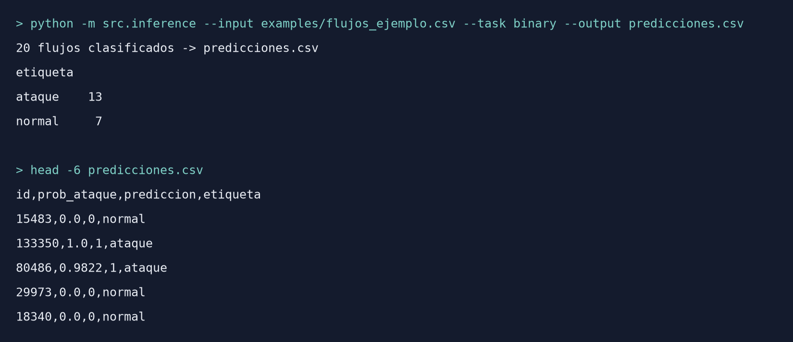
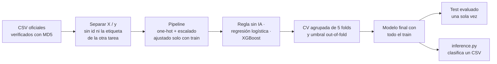

<div align="center">

# Detección de intrusiones en redes con Machine Learning

### Un detector que clasifica flujos de red como tráfico normal o ataque, y el tipo de ataque, entrenado y evaluado sobre el dataset UNSW-NB15

[](https://www.python.org/)
[](LICENSE)
[]()

[Demo en vivo](https://agusclap.github.io/ml-network-intrusion-detection/) · [Reportar un bug](../../issues) · [Pedir una funcionalidad](../../issues)

</div>

---

## 📋 Tabla de contenidos

- [Demo](#-demo)
- [Sobre el proyecto](#-sobre-el-proyecto)
  - [Contexto académico](#contexto-académico)
  - [Construido con](#construido-con)
- [El dataset](#-el-dataset)
- [Metodología](#-metodología)
- [Resultados](#-resultados)
- [Estructura del proyecto](#-estructura-del-proyecto)
- [Instalación](#-instalación)
- [Uso](#-uso)
- [Roadmap](#-roadmap)
- [Autores](#-autores)
- [Licencia](#-licencia)
- [Agradecimientos y referencias](#-agradecimientos-y-referencias)

---

## 🎬 Demo

El MVP es un script de consola: recibe un CSV con flujos de red, les aplica el mismo preprocesamiento del entrenamiento y devuelve, para cada flujo, la probabilidad de que sea un ataque y la etiqueta final. Esta es la salida real del script con los 20 flujos de ejemplo del repositorio:



**🔗 Demo en vivo:** https://agusclap.github.io/ml-network-intrusion-detection/ (página con el resumen del proyecto y los resultados).

---

## 📖 Sobre el proyecto

Un sistema de detección de intrusiones en red (NIDS) mira el tráfico y avisa cuando algo parece un ataque. Los IDS tradicionales funcionan con firmas: reglas escritas a mano para ataques que ya se conocen, que no detectan bien las variantes nuevas. Nuestra propuesta es entrenar un modelo que aprenda cómo se comporta el tráfico malicioso a partir de ejemplos etiquetados, para que funcione como una capa más de detección.

El sistema recibe los datos de un **flujo de red** (una conexión entre dos equipos resumida en números: protocolo, servicio, duración, bytes y paquetes de cada lado, TTL, etc.) y resuelve dos tareas: la **binaria** (principal), que decide si el flujo es normal o un ataque, y la **multiclase** (secundaria), que predice si es Normal o una de las 9 categorías de ataque del dataset.

Comparamos dos baselines sin IA (una regla simple y "siempre la clase más frecuente") y una regresión logística contra **XGBoost**. Validamos con cross-validation sobre el train, agrupando las filas repetidas, y evaluamos cada modelo **una sola vez** sobre el test oficial.

**Resultado principal:** XGBoost detecta el **98,3 % de los ataques del test** con un F1 de 0,898, contra 0,733 de la regla sin IA. No cumple uno de los cuatro criterios que fijamos de antemano: su tasa de falsos positivos sube de 8 % en la validación a 25 % en el test, por un sesgo del dataset en la variable TTL que analizamos en [Resultados](#-resultados).

La propuesta completa (problema, PEAS, métricas de éxito, baselines y alcance) está en el [Project Charter](PROJECT_CHARTER_CORREGIDO.md), también publicado como Issue #1. El plan de trabajo está en [PLAN_IMPLEMENTACION.md](PLAN_IMPLEMENTACION.md), el análisis detallado de los datos en [AUDITORIA_VIABILIDAD.md](AUDITORIA_VIABILIDAD.md) y un resumen de estudio del proyecto en [RESUMEN_PROYECTO.md](RESUMEN_PROYECTO.md).

### Contexto académico

- **Asignatura:** Inteligencia Artificial (Ingeniería en Informática)
- **Institución:** Universidad de la Defensa Nacional, Centro Regional Universitario Córdoba (CRUC IUA)
- **Cohorte / año:** 2026
- **Docente:** Ing. Hernando Alexis González
- **Modalidad:** grupal

### Construido con

- [Python 3.13](https://www.python.org/)
- [pandas](https://pandas.pydata.org/) / [NumPy](https://numpy.org/)
- [scikit-learn](https://scikit-learn.org/) — preprocesamiento, regresión logística, cross-validation y métricas
- [XGBoost](https://xgboost.readthedocs.io/) — modelo principal
- [matplotlib](https://matplotlib.org/) — matrices de confusión y curvas ROC
- [Jupyter](https://jupyter.org/) — análisis exploratorio y análisis de errores
- [uv](https://docs.astral.sh/uv/) — gestión de dependencias y entorno

---

## 📊 El dataset

| Campo | Detalle |
|---|---|
| Fuente | [UNSW-NB15](https://research.unsw.edu.au/projects/unsw-nb15-dataset), Australian Centre for Cyber Security, UNSW Canberra (Moustafa y Slay, 2015) |
| Registros | 175.341 en `UNSW_NB15_training-set.csv` y 82.332 en `UNSW_NB15_testing-set.csv` (la división oficial de los autores); 31 MB y 15 MB |
| Variables | 45 columnas: 42 de entrada (39 numéricas y 3 categóricas: `proto`, `service`, `state`), `id` y las dos etiquetas |
| Variable objetivo | `label` en la tarea binaria (0 = normal, 1 = ataque) y `attack_cat` en la multiclase (Normal o Analysis, Backdoor, DoS, Exploits, Fuzzers, Generic, Reconnaissance, Shellcode, Worms) |
| Período / cobertura | Tráfico generado en 2015 en el laboratorio Cyber Range de UNSW Canberra, mezclando actividad normal real con ataques sintéticos |
| Licencia del dataset | Uso libre con fines académicos y de investigación, citando los trabajos de los autores; el uso comercial requiere su acuerdo |

Los datos **no están en el repositorio** por su tamaño. En [data/README.md](data/README.md) explicamos cómo descargarlos de la fuente oficial y cómo comprobar con su hash MD5 que son exactamente los archivos que usamos. Ojo con la copia que hay en Kaggle: tiene los nombres de train y test intercambiados.

Elegimos este dataset porque es público, conocido y viene con una división oficial en train y test, así que los resultados se pueden comparar. Además permite armar un baseline sin IA con sentido y tiene problemas reales para analizar: clases que se superponen, un sesgo en el TTL y diferencias entre train y test.

---

## 🔬 Metodología



### Análisis exploratorio

El análisis está en [notebooks/01_eda_minimo.ipynb](notebooks/01_eda_minimo.ipynb). Lo que encontramos y qué decidimos a partir de eso:

- **No hay valores faltantes.** Algunos valores de `state` aparecen solo en el test, así que el encoding tiene que soportar categorías nuevas.
- **Desbalance.** 68 % de ataques en el train y 55 % en el test. Entre categorías es mucho más fuerte: Generic tiene 40.000 filas y Worms 130. Lo manejamos con pesos por clase y métricas que no se engañan con el desbalance.
- **Filas repetidas.** El 38 % de las filas del train está repetida. No las eliminamos, porque son flujos reales que se repiten (por ejemplo, durante un escaneo), pero las tenemos en cuenta al validar.
- **Filas idénticas con distinta etiqueta.** Cerca del 17 % de las filas del train tiene los mismos valores en las 42 variables que otra fila de otra categoría, sobre todo entre Analysis, Backdoor, DoS y Exploits. Ningún modelo puede separarlas: el Macro-F1 máximo posible en el train ronda 0,81.
- **Sesgo del TTL.** `sttl`, `dttl` y `ct_state_ttl` separan casi solas el tráfico normal de los ataques, por cómo se generó el tráfico en el laboratorio. No es data leakage (el TTL existe en una red real), pero sí un sesgo del dataset. Las dejamos y lo anotamos como riesgo.
- **Outliers.** Varias variables tienen valores muy extremos (por ejemplo, `sbytes` llega a casi 13 MB con una mediana de 430 bytes). No los eliminamos: en tráfico de red son legítimos y muchas veces son la señal del ataque.
- **Train y test.** Alrededor del 5 % de las filas del test también están en el train. Evaluamos sobre el test completo porque es el benchmark oficial.

### Preprocesamiento

- En cada tarea se sacan de la entrada `id` y la etiqueta de la otra tarea, porque `attack_cat` revela `label` y al revés. `get_X_y` lo verifica.
- **One-hot encoding** de las 3 categóricas. Las categorías con menos de 50 filas se agrupan en una sola columna, y quedan 188 columnas. Una categoría nueva queda con todas sus columnas en 0 y no rompe nada.
- **Estandarización** de las numéricas, solo para la regresión logística, porque es un modelo lineal y le afecta la escala. XGBoost usa árboles y no lo necesita.
- Todo va dentro de un `Pipeline` de scikit-learn que se ajusta **solo con los datos de entrenamiento** de cada fold y después se aplica a validación y test. La carpeta `data/processed/` queda vacía a propósito: no guardamos datos transformados, porque el preprocesamiento viaja con el modelo.
- **Desbalance:** pesos por clase (`class_weight` en la regresión logística y `sample_weight` en XGBoost), calculados con el fold de entrenamiento. No generamos datos sintéticos y el test nunca se balancea.
- **Etiqueta multiclase:** `attack_cat` se codifica con un `LabelEncoder` ajustado con el train y guardado junto con el modelo.

### Modelo(s)

| Modelo | Rol | Por qué |
|---|---|---|
| Regla `dpkts == 0` | Baseline sin IA (binaria) | Si el destino no respondió ningún paquete, es ataque. Es típico de escaneos y algunos DoS, y muestra cuánto se puede lograr sin aprender nada. |
| Clase mayoritaria | Baseline sin IA (multiclase) | Es el piso mínimo para la multiclase. |
| Regresión logística (L2, `C = 1`, pesos por clase) | Baseline de ML | Es un modelo lineal simple e interpretable: si XGBoost no le gana, la complejidad extra no se justifica. |
| **XGBoost** (400 árboles, profundidad 6, tasa 0,1) | Modelo principal | Funciona muy bien con datos tabulares y variables heterogéneas, combina condiciones sobre varias variables y no necesita escalado. |

Los hiperparámetros se fijaron antes de entrenar, sin búsqueda, y la semilla es 42 en todo el proyecto.

### Validación

- **Cross-validation de 5 folds** sobre el train con `StratifiedGroupKFold`: las filas con los mismos valores en las 42 variables forman un grupo y cada grupo cae entero en un fold. Así ninguna fila repetida queda en entrenamiento y en validación a la vez. Cada fold mantiene la proporción de clases del train. Lo cambiamos por recomendación de la cátedra: con un `StratifiedKFold` común, las métricas salían infladas por memorización.
- **Umbral de decisión (binaria):** con las predicciones out-of-fold elegimos el umbral con mejor F1 entre los que detectan al menos el 90 % de los ataques. Se guarda con el modelo y nunca se recalcula con el test.
- **Test:** el modelo final se entrena con todo el train y se evalúa **una sola vez** en el test oficial. `evaluate.py` se niega a correr si ese modelo ya fue evaluado.
- **Métricas:** priorizamos el recall porque en un NIDS el error más grave es un ataque no detectado, pero controlamos la tasa de falsos positivos, porque un detector que da alarma por todo no sirve. No usamos accuracy como métrica principal porque con clases desbalanceadas engaña. En la multiclase usamos Macro-F1, que pesa igual a todas las clases.

---

## 📈 Resultados

Resultados de la tarea binaria en el **test**, con cada modelo evaluado una sola vez:

| Métrica | Baseline: regla sin IA | Regresión logística | Modelo final: XGBoost |
|---|---|---|---|
| Recall (ataques detectados) | 0,658 | 0,964 | **0,983** |
| Tasa de falsos positivos | **0,167** | 0,372 | 0,251 |
| Precisión | 0,828 | 0,761 | **0,828** |
| F1 | 0,733 | 0,850 | **0,898** |
| ROC-AUC | 0,745 | 0,956 | **0,984** |
| Macro-F1 (multiclase) | 0,062 (clase mayoritaria) | 0,352 | **0,524** |


### Cross-validation sobre el train

Media ± desviación estándar de los 5 folds.

**Tarea binaria, umbral 0,5:**

| Modelo | F1 | Recall | Precisión | Tasa de falsos positivos | ROC-AUC |
|---|---|---|---|---|---|
| Regla sin IA (`dpkts == 0`) | 0,762 ± 0,003 | 0,650 ± 0,004 | 0,921 ± 0,001 | 0,119 ± 0,002 | 0,766 |
| Regresión logística | 0,950 ± 0,001 | 0,952 ± 0,001 | 0,949 ± 0,001 | 0,109 ± 0,002 | 0,984 |
| XGBoost | **0,965 ± 0,001** | **0,955 ± 0,002** | **0,976 ± 0,001** | **0,050 ± 0,002** | **0,993** |

**Tarea binaria, umbral elegido con las predicciones out-of-fold:**

| Modelo | Umbral | Recall | Tasa de falsos positivos | F1 |
|---|---|---|---|---|
| Regresión logística | 0,367 | 0,982 | 0,162 | 0,954 |
| XGBoost | 0,358 | 0,974 | 0,080 | 0,968 |

**Tarea multiclase:**

| Modelo | Macro-F1 | Weighted-F1 | Exactitud balanceada |
|---|---|---|---|
| Clase mayoritaria | 0,048 ± 0,000 | 0,155 | 0,100 |
| Regresión logística | 0,412 ± 0,005 | 0,716 | 0,585 |
| XGBoost | **0,620 ± 0,008** | **0,803** | **0,700** |

F1 por clase de XGBoost: Generic 0,990 · Normal 0,912 · Reconnaissance 0,827 · Fuzzers 0,750 · Shellcode 0,702 · Worms 0,680 · Exploits 0,652 · DoS 0,379 · Analysis 0,184 · Backdoor 0,121.

- Los dos modelos de ML superan ampliamente a la regla sin IA, que solo detecta el 65 % de los ataques.
- XGBoost detecta casi los mismos ataques que la regresión logística con menos de la mitad de falsos positivos: la logística separa las clases con una frontera lineal, y los árboles combinan condiciones sobre varias variables.
- En la multiclase, XGBoost supera a los baselines por mucho más que la variación entre folds y reconoce bien clases muy chicas como Worms y Shellcode. Analysis, Backdoor y DoS quedan bajas en todos los modelos por las filas idénticas con otras categorías.
- **Al agrupar las filas repetidas**, XGBoost binario bajó un poco (F1 de 0,967 a 0,965, falsos positivos de 4,6 % a 5,0 %): esa diferencia venía de filas de validación que el modelo ya había visto. En la multiclase, Analysis, DoS y Backdoor mejoraron (de 0,12 a 0,18, de 0,32 a 0,38 y de 0,07 a 0,12).

### Evaluación final sobre el test

**Tarea multiclase:**

| Modelo | Macro-F1 | Weighted-F1 | Exactitud balanceada |
|---|---|---|---|
| Clase mayoritaria | 0,062 | 0,279 | 0,100 |
| Regresión logística | 0,352 | 0,685 | 0,548 |
| XGBoost | **0,524** | **0,741** | **0,644** |

F1 por clase de XGBoost: Generic 0,984 · Reconnaissance 0,856 · Normal 0,759 · Worms 0,756 · Exploits 0,698 · Shellcode 0,396 · Fuzzers 0,375 · DoS 0,260 · Backdoor 0,105 · Analysis 0,053.

**Criterios de éxito fijados en el Charter antes de entrenar:**

| Criterio | Resultado en el test | ¿Se cumple? |
|---|---|---|
| Binaria: recall de al menos 0,90 | 0,983 | Sí |
| Binaria: tasa de falsos positivos no mayor que la de la regla sin IA (0,167) | 0,251 | **No** |
| Binaria: mejor F1 que los dos baselines | 0,898 contra 0,733 y 0,850 | Sí |
| Multiclase: mantener la ventaja en Macro-F1 sobre los dos baselines | 0,524 contra 0,062 y 0,352 | Sí |

Las matrices de confusión y curvas ROC de todos los modelos, en la cross-validation y en el test, están en [reports/figures/](reports/figures/), y las métricas completas en JSON en [reports/metrics/](reports/metrics/).

### Análisis crítico: por qué aumentan los falsos positivos en el test

XGBoost es el mejor modelo en las dos tareas, pero **no cumple el criterio de falsos positivos**: en la cross-validation tenía 8,0 % y en el test sube a 25,1 %. Casi todas las falsas alarmas vienen de una sola variable, `sttl` (el TTL de los paquetes del origen). Proporción de flujos con cada valor:

| `sttl` | Normales en train | Ataques en train | Normales en test |
|---|---|---|---|
| 31 | 70,5 % | 0 % | 45,1 % |
| 254 | 20,1 % | 86,7 % | 40,7 % |

- En el train, `sttl = 254` aparece en el 87 % de los ataques y solo en el 20 % del tráfico normal, así que el modelo lo aprendió como señal de ataque. Es el sesgo del TTL que ya habíamos marcado como riesgo.
- En el test, el tráfico normal con `sttl = 254` se duplica. De los 9.283 falsos positivos de XGBoost, 8.099 (el 87 %) tienen ese valor. Los flujos normales con `sttl = 31` no generan ninguna falsa alarma.
- No es algo solo de nuestro modelo: la regla sin IA también empeora (de 0,119 a 0,167). El tráfico normal del test es distinto al del train.
- El modelo multiclase clasifica como Fuzzers 7.402 de esas falsas alarmas; por eso en el test baja el F1 de Normal y la precisión de Fuzzers es de 0,26.
- El ROC-AUC sigue en 0,984: el modelo ordena bien los flujos. Lo que falla es el umbral elegido con el train, porque cambió la distribución del tráfico normal.

**No cambiamos el umbral ni el modelo después de ver el test**, porque el resultado dejaría de ser una evaluación independiente. Lo reportamos como está. El análisis completo está en [notebooks/02_analisis_test.ipynb](notebooks/02_analisis_test.ipynb). Para usar el modelo en otra red habría que volver a elegir el umbral con tráfico de esa red o entrenar sin las variables de TTL (ver [Roadmap](#-roadmap)).

### Reproducibilidad

- Los datos se verifican con su MD5 antes de usarlos, la semilla es 42 en todo el proyecto y las versiones de las librerías están fijas en `pyproject.toml` y `requirements.txt`.
- En la misma máquina, volver a correr todo da exactamente los mismos números. Lo comprobamos clonando el repositorio en un entorno nuevo y repitiendo el entrenamiento y la evaluación: los JSON de métricas salen idénticos.
- En otra máquina (Linux con 8 núcleos, contra Windows con 20) los datos, los grupos y los folds salen idénticos, pero los modelos cambian en el tercer decimal por diferencias de redondeo del procesador. Eso mueve un poco el umbral (0,346 en vez de 0,358 en XGBoost) sin cambiar las conclusiones: en esa máquina XGBoost dio en la cross-validation un recall de 0,976 y una tasa de falsos positivos de 0,084.

---

## 📂 Estructura del proyecto

```text
.
├── README.md
├── pyproject.toml              # dependencias con versiones exactas
├── requirements.txt            # todas las dependencias, incluidas las transitivas, fijadas
├── LICENSE
├── AGENTS.md                   # instrucciones de la plantilla de la cátedra
├── PROJECT_CHARTER_CORREGIDO.md, PLAN_IMPLEMENTACION.md,
│   AUDITORIA_VIABILIDAD.md, RESUMEN_PROYECTO.md   # documentación del proyecto
├── src/
│   ├── config.py               # semilla, rutas, hashes MD5, columnas e hiperparámetros
│   ├── data.py                 # verificación y carga de los datos; X / y sin la etiqueta de la otra tarea
│   ├── features.py             # preprocesamiento (one-hot y escalado)
│   ├── baselines.py            # regla sin IA y clase mayoritaria
│   ├── metrics.py              # métricas y elección del umbral
│   ├── train.py                # cross-validation, umbral y entrenamiento del modelo final
│   ├── evaluate.py             # evaluación única de los modelos guardados sobre el test
│   ├── plots.py                # matrices de confusión y curvas ROC
│   └── inference.py            # el MVP: clasifica un CSV de flujos con un modelo guardado
├── notebooks/
│   ├── 01_eda_minimo.ipynb     # análisis exploratorio
│   └── 02_analisis_test.ipynb  # análisis de los errores en el test
├── data/
│   ├── README.md               # cómo descargar y verificar los datos
│   ├── raw/                    # los dos CSV oficiales (no se suben)
│   └── processed/              # vacía: el preprocesamiento va dentro del Pipeline del modelo
├── models/                     # modelos entrenados (no se suben, se generan con train.py)
├── reports/
│   ├── metrics/                # métricas en JSON (*_cv.json y *_test.json)
│   └── figures/                # matrices de confusión y curvas ROC
├── examples/                   # CSV de ejemplo para probar inference.py
├── tests/                      # vacía: no hay tests automáticos (ver Roadmap)
└── docs/                       # demo estática (GitHub Pages) e imágenes del README
    ├── index.html
    ├── img/
    └── assets/
```

---

## ⚙️ Instalación

### Prerrequisitos

- [uv](https://docs.astral.sh/uv/getting-started/installation/) (o Python 3.12 o superior con `pip`)
- Git

### Pasos

```bash
# 1. Cloná el repositorio
git clone https://github.com/agusclap/ml-network-intrusion-detection.git
cd ml-network-intrusion-detection

# 2. Creá el entorno virtual (probado con Python 3.13)
uv venv --python 3.13

# 3. Activalo
# Windows:
.venv\Scripts\activate
# Linux/Mac:
source .venv/bin/activate

# 4. Instalá las dependencias
uv pip install -e .
```

Sin uv, el mismo resultado se logra con `python -m venv .venv`, activando el entorno y corriendo `pip install -e .`. Para replicar exactamente nuestro entorno, incluidas las dependencias transitivas, está `pip install -r requirements.txt`.

**5. Descargá los datos.** Seguí los pasos de [data/README.md](data/README.md) para bajar los dos CSV oficiales y dejarlos en `data/raw/`. Después verificalos:

```bash
python -m src.data
```

El proyecto no usa variables de entorno ni credenciales, así que no hace falta un archivo `.env`.

---

## ▶️ Uso

Todos los comandos se corren desde la raíz del repositorio, con el entorno activado.

```bash
# Cross-validation, elección del umbral y entrenamiento del modelo final (guarda models/*.joblib)
python -m src.train --model xgb                       # tarea binaria (también: heuristic, lr)
python -m src.train --task multiclass --model xgb     # tarea multiclase

# Evaluación final sobre el test, con los modelos ya entrenados
python -m src.evaluate --task binary --model xgb      # también: heuristic, lr
python -m src.evaluate --task multiclass --model xgb

# Clasificar un CSV de flujos con el modelo guardado
python -m src.inference --input examples/flujos_ejemplo.csv --task binary --output predicciones.csv
python -m src.inference --input examples/flujos_ejemplo.csv --task multiclass --output predicciones.csv
```

Entrenar los 6 modelos (3 por tarea) tarda unos 9 minutos en nuestra máquina. Cada corrida de `train.py` imprime las métricas de cada fold y su promedio, y guarda el modelo y sus métricas en `models/` y `reports/metrics/`.

`inference.py` verifica que el CSV tenga las 42 columnas que espera el modelo (si falta alguna, corta con un error que dice cuáles; si sobran, las ignora con un aviso), aplica el preprocesamiento y el umbral guardados, y escribe un CSV con el `id`, la probabilidad y la etiqueta de cada flujo. La salida esperada es la de la captura de la [Demo](#-demo). En la tarea multiclase devuelve la categoría y su probabilidad.

`evaluate.py` no entrena nada: carga el modelo guardado y calcula las métricas sobre el test. Como las métricas del test ya están en el repositorio, para volver a evaluar hay que borrar antes los `reports/metrics/*_test.json`; si no, se niega a correr, para que el test no se evalúe dos veces sin querer. Con `--split train` se puede probar el script sin tocar el test.

Los notebooks se abren con Jupyter (o desde VS Code) usando el kernel del entorno `.venv`. `01_eda_minimo.ipynb` necesita los datos y `02_analisis_test.ipynb` necesita además los modelos entrenados.

---

## 🗺️ Roadmap

- [ ] Entrenar sin las variables de TTL (`sttl`, `dttl`, `ct_state_ttl`) para medir cuánto dependen los modelos de ese sesgo y si se vuelven más robustos en el test.
- [ ] Evaluar sobre la parte del test que no aparece en el train, y recalibrar el umbral con tráfico de la red donde se vaya a usar.
- [ ] Probar unas pocas configuraciones de XGBoost con cross-validation y analizar qué variables pesan más en las predicciones.
- [ ] Sumar tests automáticos de la carga de datos y de `inference.py`, y una demo interactiva que clasifique un CSV subido por el usuario.

---

## 👥 Autores

- **Maximo Agustin Rodeyro** — [GitHub](https://github.com/agusclap). Configuración, carga de datos, preprocesamiento, entrenamiento con cross-validation, evaluación, script de inferencia y documentación.
- **Lautaro Niccolini** — [GitHub](https://github.com/Lauti00). Análisis exploratorio, baselines y métricas, matrices de confusión y curvas ROC, y prueba de reproducibilidad en otra máquina.

Trabajamos con la rama `main` siempre estable y una rama por tarea. En cada commit indicamos qué se hizo y cuántas horas llevó, por ejemplo `feat(data): verificación MD5 de los CSV oficiales [0.5h]`.

---

## 📄 Licencia

El código de este proyecto está bajo la licencia [MIT](LICENSE). Ver el archivo `LICENSE` para más detalle. El dataset UNSW-NB15 no se redistribuye en este repositorio y tiene sus propias condiciones de uso (ver [El dataset](#-el-dataset)).

---

## 🙏 Agradecimientos y referencias

- Moustafa, N. y Slay, J. (2015). UNSW-NB15: a comprehensive data set for network intrusion detection systems (UNSW-NB15 network data set). *Military Communications and Information Systems Conference (MilCIS)*, IEEE. https://doi.org/10.1109/MilCIS.2015.7348942
- Moustafa, N. y Slay, J. (2016). The evaluation of Network Anomaly Detection Systems: Statistical analysis of the UNSW-NB15 dataset and the comparison with the KDD99 dataset. *Information Security Journal: A Global Perspective*.
- UNSW Canberra. The UNSW-NB15 Dataset. https://research.unsw.edu.au/projects/unsw-nb15-dataset
- Documentación de [scikit-learn](https://scikit-learn.org/stable/) (`Pipeline`, `ColumnTransformer`, `StratifiedGroupKFold`) y de [XGBoost](https://xgboost.readthedocs.io/).
- Al Ing. Hernando Alexis González, por la revisión del proyecto y la recomendación de agrupar las filas repetidas en la cross-validation.
