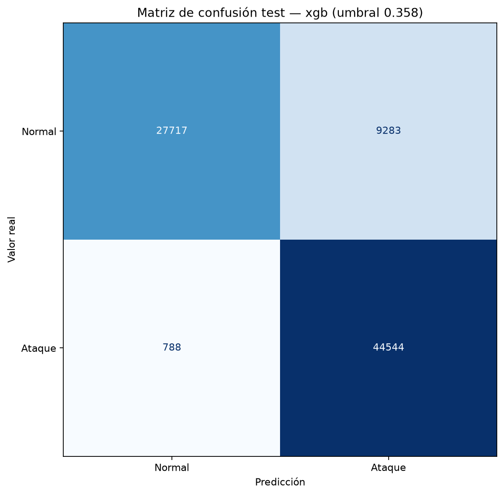

# Detección de intrusiones en redes con Machine Learning

Trabajo final de Inteligencia Artificial - Ingeniería en Informática - Universidad de la Defensa Nacional (CRUC IUA), 2026.

Docente: Ing. Hernando Alexis González. Modalidad grupal.

## Integrantes

- Maximo Agustin Rodeyro
- Lautaro Niccolini

## De qué se trata

Armamos un sistema de detección de intrusiones (NIDS) basado en Machine Learning. A partir de los datos de un flujo de red, el modelo decide si ese flujo es tráfico normal o un ataque. Como segunda tarea, también intenta predecir qué tipo de ataque es.

Trabajamos con el dataset [UNSW-NB15](https://research.unsw.edu.au/projects/unsw-nb15-dataset), usando la división en train y test que publicaron sus autores.

## Estado actual

El MVP está completo: el pipeline funciona en las dos tareas, está validado con cross-validation sobre el train, los modelos se evaluaron una sola vez sobre el test y hay un script que clasifica un CSV de flujos con el modelo guardado.

- [x] Carga de los datos oficiales con verificación de integridad (MD5)
- [x] Análisis exploratorio, con outliers, entropía y duplicados ([notebooks/01_eda_minimo.ipynb](notebooks/01_eda_minimo.ipynb))
- [x] Preprocesamiento: one-hot de las categóricas y estandarización de las numéricas para la regresión logística
- [x] Baselines: regla sin IA (`dpkts == 0`) y clase mayoritaria
- [x] Cross-validation agrupada de 5 folds con la regla, la regresión logística y XGBoost, en las dos tareas
- [x] Script de predicción por consola
- [x] Evaluación final sobre el test, con matrices de confusión y curvas ROC
- [x] Análisis de los errores en el test ([notebooks/02_analisis_test.ipynb](notebooks/02_analisis_test.ipynb))
- [x] Revisión de reproducibilidad en otra máquina

## Propuesta del proyecto

La propuesta completa (problema, PEAS, datos, métricas de éxito, baselines y alcance) está en [PROJECT_CHARTER_CORREGIDO.md](PROJECT_CHARTER_CORREGIDO.md) y también en el Issue #1 del repositorio.

En resumen:

- **Tarea principal:** clasificación binaria (normal o ataque).
- **Tarea secundaria:** clasificación multiclase (Normal o una de las 9 categorías de ataque).
- **Baselines:** una regla sin IA (`dpkts == 0`, es decir, el destino no respondió) y una regresión logística.
- **Modelo principal:** XGBoost.
- **Validación:** cross-validation de 5 folds sobre el train, agrupando las filas repetidas para que no queden en entrenamiento y validación a la vez. El test se usa una sola vez, al final.
- **Objetivo en la tarea binaria:** detectar al menos el 90 % de los ataques sin tener más falsos positivos que la regla sin IA.
- **Objetivo en la tarea multiclase:** superar a los baselines en Macro-F1.

## Datos

| Archivo | Registros | Para qué lo usamos |
|---|---|---|
| `UNSW_NB15_training-set.csv` | 175.341 | Entrenamiento y cross-validation |
| `UNSW_NB15_testing-set.csv` | 82.332 | Evaluación final |

Los datos no están en el repositorio porque son pesados. En [data/README.md](data/README.md) explicamos cómo descargarlos y cómo comprobar que son los archivos correctos.

Ojo con la copia del dataset que hay en Kaggle: tiene los nombres de train y test intercambiados.

## Estructura del repositorio

```
data/              datos (no se suben, ver data/README.md)
examples/          CSV de ejemplo para probar el script de predicción
notebooks/         análisis exploratorio y análisis de los errores en el test
src/
  config.py        semilla, rutas, hashes de los datos, columnas e hiperparámetros
  data.py          verificación y carga de los datos; separación en X e y sin el target de la otra tarea
  features.py      preprocesamiento (one-hot y escalado)
  baselines.py     regla sin IA y clase mayoritaria
  metrics.py       métricas y elección del umbral
  train.py         cross-validation, umbral y entrenamiento del modelo final
  evaluate.py      evaluación única de los modelos guardados sobre el test
  plots.py         matrices de confusión y curvas ROC
  inference.py     predicción sobre un CSV de flujos con un modelo guardado
models/            modelos entrenados (no se suben, se generan con train.py)
reports/metrics/   métricas en JSON (*_cv.json de la cross-validation, *_test.json del test)
reports/figures/   matrices de confusión y curvas ROC (*_test_* son del test)
```

## Instalación y uso

Probado con Python 3.13.

```bash
# Crear el entorno e instalar dependencias
python -m venv .venv
.venv\Scripts\activate          # en Linux/Mac: source .venv/bin/activate
pip install -r requirements.txt

# Descargar los datos según data/README.md y verificarlos
python -m src.data

# Cross-validation y entrenamiento final
python -m src.train --model xgb                       # tarea binaria (también: heuristic, lr)
python -m src.train --task multiclass --model xgb     # tarea multiclase

# Evaluación final sobre el test (con los modelos ya entrenados)
python -m src.evaluate --task binary --model xgb      # también: heuristic, lr
python -m src.evaluate --task multiclass --model xgb

# Clasificar un CSV de flujos con el modelo guardado
python -m src.inference --input examples/flujos_ejemplo.csv --task binary --output predicciones.csv
```

Cada corrida de `train.py` imprime las métricas de cada fold y su promedio, guarda el modelo entrenado con todo el train en `models/` y las métricas en `reports/metrics/`. `inference.py` verifica que el CSV tenga las columnas que espera el modelo, aplica el mismo preprocesamiento del entrenamiento y el umbral guardado, y escribe la predicción y la probabilidad de cada flujo.

`evaluate.py` no entrena nada: carga el modelo guardado y su umbral, y calcula las métricas sobre el test. Si el JSON de ese modelo ya existe, se niega a correr, para que el test no se evalúe dos veces sin querer. Con `--split train` se puede probar el script sin tocar el test.

Para reproducir todo desde cero hay que correr `train.py` y después `evaluate.py` con cada modelo (heuristic, lr y xgb) en las dos tareas. Sobre la reproducibilidad entre distintas máquinas, ver la sección [Reproducibilidad](#reproducibilidad).

## Resultados

Primero elegimos y validamos los modelos con cross-validation de 5 folds sobre el train (media ± desviación estándar). Las filas idénticas se agrupan en el mismo fold, así que el modelo nunca se evalúa con una fila que ya vio al entrenar. Después evaluamos cada modelo una sola vez sobre el test, sin cambiar nada.

### Cross-validation: tarea binaria

Con el umbral por defecto (0,5):

| Modelo | F1 | Recall | Precisión | Tasa de falsos positivos | ROC-AUC |
|---|---|---|---|---|---|
| Regla sin IA (`dpkts == 0`) | 0,762 ± 0,003 | 0,650 ± 0,004 | 0,921 ± 0,001 | 0,119 ± 0,002 | 0,766 |
| Regresión logística | 0,950 ± 0,001 | 0,952 ± 0,001 | 0,949 ± 0,001 | 0,109 ± 0,002 | 0,984 |
| XGBoost | **0,965 ± 0,001** | **0,955 ± 0,002** | **0,976 ± 0,001** | **0,050 ± 0,002** | **0,993** |

Con el umbral elegido usando las predicciones out-of-fold (el de mejor F1 entre los que dan recall de 0,90 o más):

| Modelo | Umbral | Recall | Tasa de falsos positivos | F1 |
|---|---|---|---|---|
| Regresión logística | 0,367 | 0,982 | 0,162 | 0,954 |
| XGBoost | 0,358 | 0,974 | 0,080 | 0,968 |

- Los dos modelos de ML superan ampliamente a la regla sin IA, que solo detecta el 65 % de los ataques.
- XGBoost detecta casi la misma proporción de ataques que la regresión logística, pero con menos de la mitad de falsos positivos. La regresión logística separa las clases con una frontera lineal; los árboles de XGBoost pueden combinar condiciones sobre varias variables, y en este problema eso marca la diferencia.
- Con su umbral, XGBoost cumple el criterio de la tarea binaria (recall de al menos 0,90 con menos falsos positivos que la regla sin IA). La regresión logística, para llegar a ese recall, tiene más falsos positivos que la regla.

### Cross-validation: tarea multiclase

| Modelo | Macro-F1 | Weighted-F1 | Exactitud balanceada |
|---|---|---|---|
| Clase mayoritaria | 0,048 ± 0,000 | 0,155 | 0,100 |
| Regresión logística | 0,412 ± 0,005 | 0,716 | 0,585 |
| XGBoost | **0,620 ± 0,008** | **0,803** | **0,700** |

F1 por clase de XGBoost: Generic 0,990 · Normal 0,912 · Reconnaissance 0,827 · Fuzzers 0,750 · Shellcode 0,702 · Worms 0,680 · Exploits 0,652 · DoS 0,379 · Analysis 0,184 · Backdoor 0,121.

- XGBoost supera a los dos baselines por mucho más que la variación entre folds, así que cumple el criterio de la tarea multiclase.
- Reconoce bien incluso clases muy chicas como Worms y Shellcode, gracias a los pesos por clase.
- Analysis, Backdoor y DoS quedan bajas en todos los modelos: muchas de sus filas tienen exactamente los mismos valores que filas de otras categorías, sobre todo Exploits, y ningún modelo puede distinguirlas.

### Qué cambió al agrupar las filas repetidas

Antes usábamos un `StratifiedKFold` común. Por recomendación de la cátedra pasamos a `StratifiedGroupKFold`, que pone todas las repeticiones de una fila en el mismo fold:

- En la tarea binaria, XGBoost bajó un poco (F1 de 0,967 a 0,965, tasa de falsos positivos de 4,6 % a 5,0 %): parte del resultado anterior venía de filas de validación que el modelo ya había visto al entrenar.
- En la multiclase, Analysis, DoS y Backdoor mejoraron (de 0,12 a 0,18, de 0,32 a 0,38 y de 0,07 a 0,12). Lo más probable es que antes, al ver en entrenamiento una fila repetida con la etiqueta más frecuente de su grupo, el modelo aprendiera esa etiqueta y fallara en validación con las repeticiones de las clases minoritarias.

### Evaluación final sobre el test

Cada modelo se evaluó una sola vez, con el umbral elegido en el train. Después de eso no se cambió nada.

**Tarea binaria**

| Modelo | Recall | Tasa de falsos positivos | Precisión | F1 | ROC-AUC |
|---|---|---|---|---|---|
| Regla sin IA (`dpkts == 0`) | 0,658 | 0,167 | 0,828 | 0,733 | 0,745 |
| Regresión logística (umbral 0,367) | 0,964 | 0,372 | 0,761 | 0,850 | 0,956 |
| XGBoost (umbral 0,358) | **0,983** | 0,251 | **0,828** | **0,898** | **0,984** |



**Tarea multiclase**

| Modelo | Macro-F1 | Weighted-F1 | Exactitud balanceada |
|---|---|---|---|
| Clase mayoritaria | 0,062 | 0,279 | 0,100 |
| Regresión logística | 0,352 | 0,685 | 0,548 |
| XGBoost | **0,524** | **0,741** | **0,644** |

F1 por clase de XGBoost: Generic 0,984 · Reconnaissance 0,856 · Normal 0,759 · Worms 0,756 · Exploits 0,698 · Shellcode 0,396 · Fuzzers 0,375 · DoS 0,260 · Backdoor 0,105 · Analysis 0,053.

**Criterios de éxito del Charter**

| Criterio | Resultado en el test | ¿Se cumple? |
|---|---|---|
| Binaria: recall de al menos 0,90 | 0,983 | Sí |
| Binaria: tasa de falsos positivos no mayor que la de la regla sin IA (0,167) | 0,251 | **No** |
| Binaria: mejor F1 que los dos baselines | 0,898 contra 0,733 y 0,850 | Sí |
| Multiclase: mantener la ventaja en Macro-F1 sobre los dos baselines | 0,524 contra 0,062 y 0,352 | Sí |

XGBoost sigue siendo el mejor modelo en las dos tareas y detecta el 98 % de los ataques del test, pero **no cumple el criterio de falsos positivos**: en la cross-validation tenía 8,0 % y en el test sube a 25,1 %. No cambiamos el umbral ni el modelo después de ver el test, porque entonces el resultado dejaría de ser una evaluación independiente. Lo reportamos como está y explicamos la causa en la sección siguiente.

### Por qué aumentan los falsos positivos en el test

Casi todas las falsas alarmas vienen de una sola variable, `sttl` (el TTL de los paquetes del origen). Proporción de flujos con cada valor:

| `sttl` | Normales en train | Ataques en train | Normales en test |
|---|---|---|---|
| 31 | 70,5 % | 0 % | 45,1 % |
| 254 | 20,1 % | 86,7 % | 40,7 % |

- En el train, `sttl = 254` aparece en el 87 % de los ataques y solo en el 20 % del tráfico normal, así que el modelo aprendió a usarlo como señal de ataque. Es el sesgo del TTL que ya habíamos marcado como limitación del dataset en el Charter.
- En el test, la proporción de tráfico normal con `sttl = 254` se duplica (del 20 % al 41 %). De los 9.283 falsos positivos de XGBoost, 8.099 (el 87 %) tienen ese valor. En cambio, los flujos normales con `sttl = 31`, que son el 45 % del tráfico normal del test, no generan ninguna falsa alarma.
- No es algo solo de nuestro modelo: la regla sin IA también empeora (de 0,119 a 0,167). El tráfico normal del test es distinto al del train.
- En la multiclase pasa lo mismo: el modelo multiclase clasifica como Fuzzers 7.402 de esas falsas alarmas. Por eso en el test baja el F1 de Normal y la precisión de Fuzzers es de apenas 0,26.
- El ROC-AUC sigue siendo alto (0,984): el modelo sigue ordenando bien los flujos de más a menos sospechosos. Lo que deja de funcionar es el umbral elegido en el train, porque la distribución del tráfico normal cambió.

El código de este análisis está en [notebooks/02_analisis_test.ipynb](notebooks/02_analisis_test.ipynb). Para usar el modelo en otra red habría que volver a elegir el umbral con tráfico de esa red, o entrenar sin las variables de TTL. Las dos cosas quedan fuera del alcance de este trabajo.

## Reproducibilidad

- Los datos se verifican con su MD5 antes de usarlos, la semilla es 42 en todo el proyecto y las versiones de las librerías están fijas en `requirements.txt`.
- En la misma máquina, volver a correr todo da exactamente los mismos números: lo comprobamos repitiendo la cross-validation completa.
- En otra máquina (Linux con 8 núcleos, contra Windows con 20 núcleos) los datos, los grupos y los folds salen idénticos, pero al entrenar la regresión logística y XGBoost los resultados cambian en el tercer decimal. Son diferencias de redondeo en los cálculos, que dependen del sistema y del procesador. Esa pequeña diferencia mueve un poco el umbral elegido (0,346 en vez de 0,358 en XGBoost), sin cambiar las conclusiones: en esa máquina XGBoost dio en la cross-validation un recall de 0,976 y una tasa de falsos positivos de 0,084.
- Los números de este README, los JSON y las figuras salen todos de la misma máquina.

## Cosas a tener en cuenta del dataset

- Para que el modelo no "vea la respuesta", en cada tarea sacamos de la entrada la columna `id` y la etiqueta que no corresponde (`attack_cat` en la tarea binaria y `label` en la multiclase).
- Hay registros con exactamente los mismos valores pero distinta categoría de ataque, sobre todo entre Analysis, Backdoor, DoS y Exploits. Por eso ningún modelo puede separar esas clases del todo.
- Las variables de TTL (`sttl`, `dttl`, `ct_state_ttl`) separan casi solas el tráfico normal de los ataques, por cómo se generó el tráfico en el laboratorio. Las dejamos en el modelo y lo tomamos como una limitación del dataset. En el test se ve el costo de esa decisión: la mayoría de los falsos positivos vienen de `sttl` (ver [Por qué aumentan los falsos positivos en el test](#por-qué-aumentan-los-falsos-positivos-en-el-test)).
- En el train el 68 % de los registros son ataques y en el test el 55 %. Además, alrededor del 5 % de las filas del test también están en el train.
- El 38 % de las filas del train está repetido. No lo eliminamos porque son flujos reales que se repiten, no errores de carga; para que no infle la validación, la cross-validation agrupa las repeticiones en el mismo fold.
- Los valores extremos de las variables numéricas tampoco se eliminan: en tráfico de red son legítimos y muchas veces son la señal del ataque.

La justificación de cada decisión y su relación con el teórico de la materia está en la sección 3 y en la tabla "Relación con los contenidos de la materia" del [Charter](PROJECT_CHARTER_CORREGIDO.md). El análisis completo de los datos está en [AUDITORIA_VIABILIDAD.md](AUDITORIA_VIABILIDAD.md) y un resumen del proyecto en [RESUMEN_PROYECTO.md](RESUMEN_PROYECTO.md).

## Cronograma

| Semana | Fechas | Qué hacemos | Estado |
|---|---|---|---|
| 1 | 28/9 – 4/10 | Repositorio, entorno, carga de datos y análisis exploratorio | Hecho |
| 2 | 5/10 – 11/10 | Preprocesamiento, regla sin IA y regresión logística binaria | Hecho |
| 3 | 12/10 – 18/10 | XGBoost binario y complemento del análisis exploratorio | Hecho |
| 4 | 19/10 – 25/10 | Tarea multiclase | Hecho |
| 5 | 26/10 – 1/11 | Consulta con la cátedra, script de predicción y validación agrupada | Hecho |
| 6 | 2/11 – 8/11 | Evaluación final en el test, figuras, análisis de errores y reproducibilidad | Hecho |
| 7 | 9/11 – 13/11 | Documentación final y preparación de la defensa. Entrega el viernes 13/11 | En curso |

La evaluación sobre el test la dejamos para después de la consulta con la cátedra, para incorporar sus correcciones sin haber mirado todavía el test. El detalle está en [PLAN_IMPLEMENTACION.md](PLAN_IMPLEMENTACION.md).

## Forma de trabajo

- La rama `main` tiene siempre una versión estable y cada tarea se hace en su propia rama.
- En los commits ponemos qué se hizo y cuántas horas llevó, por ejemplo: `feat(data): carga y verificación de los CSV [1.5h]`.

## Referencias

- Moustafa, N. y Slay, J. (2015). UNSW-NB15: a comprehensive data set for network intrusion detection systems (UNSW-NB15 network data set). Military Communications and Information Systems Conference (MilCIS). https://doi.org/10.1109/MilCIS.2015.7348942
- UNSW Canberra. The UNSW-NB15 Dataset. https://research.unsw.edu.au/projects/unsw-nb15-dataset
